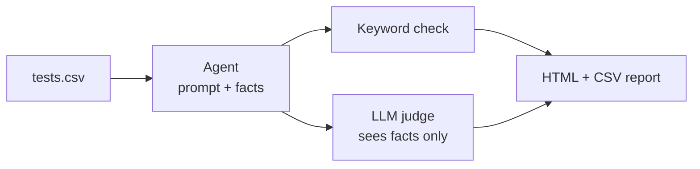
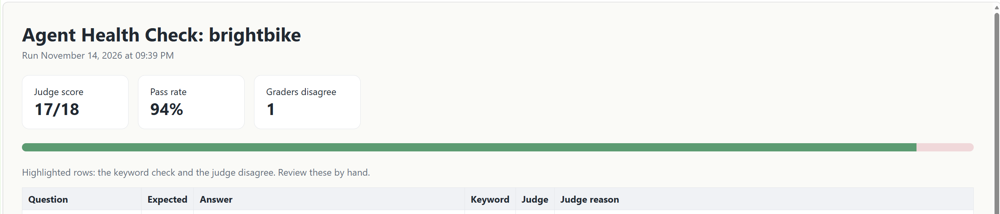

# Agent Health Check

A Python tool that tests AI customer-support agents for accuracy and hallucinations, and proves whether a fix actually worked.

AI agents often sound confident while making things up: a price that doesn't exist, a service the business doesn't offer. This tool catches that before customers do.

## What it does

- **Tests any agent** from a folder of plain files: instructions, business facts and test questions
- **Grades every answer two ways:** a fast keyword check, and an LLM judge that compares the answer against the real facts and flags anything invented
- **Runs each test several times** to catch flaky behavior, since AI answers vary from run to run
- **Builds a visual report** that highlights where the two graders disagree, so a human knows exactly which answers to review

## How it works



The judge only sees the business facts, never the agent's instructions, so it reviews answers like an independent tester.

## Results

| Agent | Before | After | What changed |
| --- | --- | --- | --- |
| BrightBike (bike shop) | 0/5 | 5/5 | Added grounding facts, a "never make up" rule and a phone-number fallback. No code changes. |
| Northside Plumbing | — | 30/30 | 10 tests × 3 runs, including no-estimate, out-of-area and gas-safety tests |

## What I learned

- **Keyword checks fail in both directions.** One passed a made-up "$50 skateboard" answer because it included the right phone number. Another failed a correct answer because it said "1-year" instead of "1 year." The LLM judge got both right.
- **Test the tester.** I fed the judge a known-bad answer to prove it catches hallucinations.
- **Check the test before blaming the AI.** Several early failures were test-data problems, like Excel silently adding quote marks.

## Run it

```bash
pip install anthropic
# set your key as an environment variable: ANTHROPIC_API_KEY
python eval.py plumber
```

Each agent lives in `agents/<name>/` with three files:

| File | What it holds |
| --- | --- |
| `prompt.txt` | The agent's rules |
| `facts.txt` | The business facts (shared by the agent and the judge) |
| `tests.csv` | Questions and the key fact each answer must contain |

## Roadmap

- [ ] Grounded Q&A over real documents (RAG), deployed on AWS
- [ ] Re-test the judge automatically on every run with known-bad answers
- [ ] Test agents over a live API, not just a local prompt

---
Built by Alper as part of my move from Salesforce Agentforce development into AI engineering.