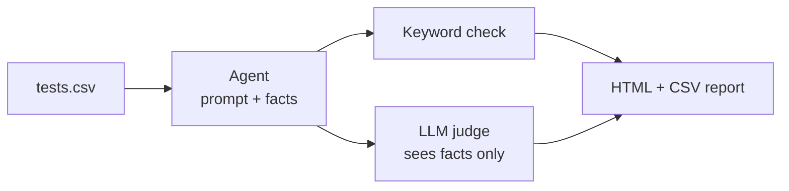

# AI Engineering Journey

Three Python projects about one question: **how do you make AI answers accurate and trustworthy?** Built while moving from Salesforce Agentforce development into AI engineering.

More at [alperbattal.com](https://alperbattal.com).

| Project | Folder | What it does | Result |
| --- | --- | --- | --- |
| Agent Health Check | `/` and `agents/` | Tests AI support agents for accuracy and hallucinations | A bike-shop agent went from 0/5 to 5/5 by fixing its instructions |
| Handbook Assistant | `rag/` | Answers questions from a handbook, with citations (RAG) | Retrieval 9/9, answers 12/12 on a deliberately hard test set |
| Job-Match Assistant | `jobmatch/` | Compares candidates and jobs across documents; routes each question | Fair search fixed a comparison that left a candidate out |

## 1. Agent Health Check

Grades every agent answer two ways: a fast keyword check, and an **LLM judge** that sees only the real business facts and flags anything invented. Runs each test several times to catch flaky answers, and builds an HTML report that highlights where the two graders disagree.




```bash
python eval.py plumber
```

Each agent lives in `agents/<name>/` with `prompt.txt` (rules), `facts.txt` (business facts) and `tests.csv` (questions and the key fact each answer must contain).

## 2. Handbook Assistant (RAG)

Answers questions from a company handbook, citing the section it used. Searches by **meaning** with embeddings, so "Can I bring my dog?" finds the rule about pets. A minimum score keeps unrelated questions from reaching the model.

Its eval checks the **search** and the **answer** separately, so every failure points to the right fix: the search settings or the prompt. It also compares chunk sizes.

```bash
cd rag
python rag_semantic.py                       # chat with the handbook
python rag_eval.py rag_tests_hard.csv 40     # run the eval with 40-word chunks
```

## 3. Job-Match Assistant

Reads several fictional resumes and job postings, and cites the **source file** for every fact. Before searching, Claude **routes** each question:

- **Lookup** ("Who knows AWS?") gets a fast top-5 search.
- **Compare** ("Who's the best fit?") gets a fair search with the best pieces from *every* document, so no candidate is left out.

```bash
cd jobmatch
python match.py
```

## What I learned

- **Keyword checks fail both ways.** One passed a made-up answer that happened to include the right phone number; another failed a correct answer that said "1-year" instead of "1 year."
- **Test the tester.** Feed the judge answers you know are wrong, and make sure it catches them.
- **Check the test before blaming the AI.** Several early failures were bad test data.
- **Plain search isn't fair for comparisons.** Top-5 search can leave a document out entirely.
- **Measure before fixing.** A cut-off answer turned out to be a token limit; checking `stop_reason` found it.

## Setup

```bash
pip install anthropic
```

Set two environment variables: `ANTHROPIC_API_KEY` (Claude) and `VOYAGE_API_KEY` (embeddings, for `rag/` and `jobmatch/`). Keys are never stored in the code.

## Roadmap

- [x] Deploy the handbook assistant to AWS
- [ ] Test the job-match router with its own eval
- [ ] Re-test the judge automatically on every run with known-bad answers

**Deployed on AWS Lambda.** The assistant runs in the cloud with no installed packages: Claude and Voyage are called directly with Python's built-in `urllib`. A token-protected Function URL keeps strangers from using the API, and requests without the right token are rejected before any API call is made.

Every change follows the same cycle: test locally → regression test with the eval → zip → upload → verify in the cloud. `rag_eval.py` can test either version (set `HANDBOOK_URL` and `HANDBOOK_TOKEN` to point it at the cloud).